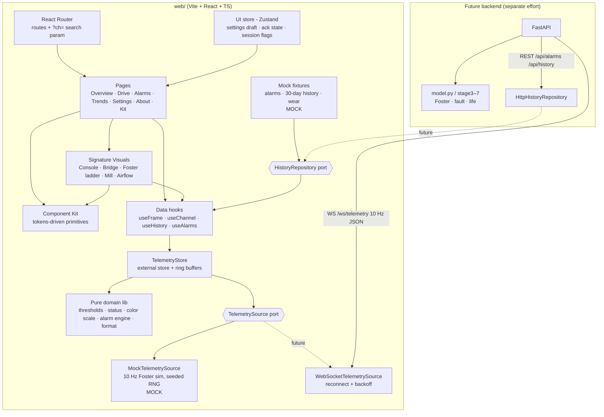
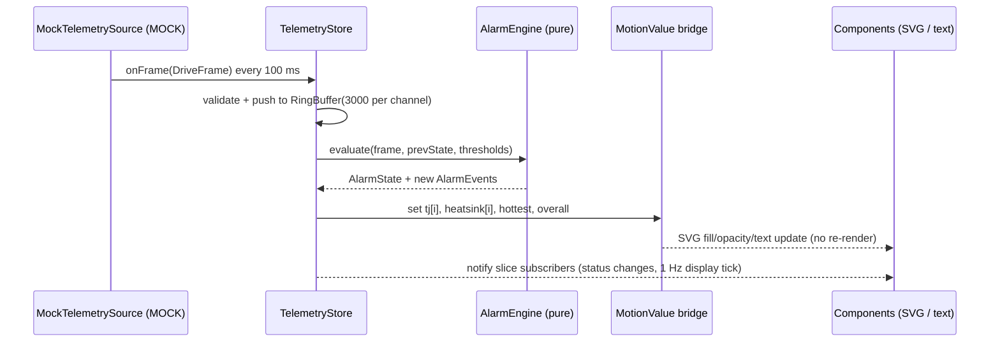
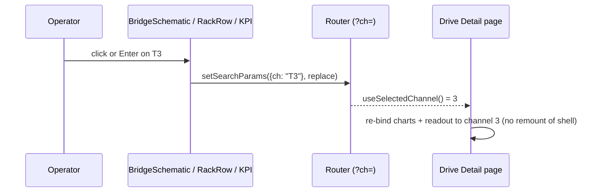
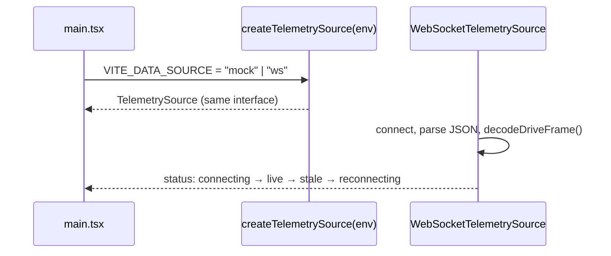

# Design Document: THERMOSENSE Frontend Redesign

## Overview

THERMOSENSE estimates thyristor junction temperature (Tj) for a 6-pulse DC mill drive at Tata Steel, using a 3-stage Foster RC model fed by heatsink RTDs, ambient temperature and armature current. The current Streamlit dashboard works, but it looks generic and has structural defects: the `st.html` sanitizer strips SVGs, a CSS `@import` returns 404, every selection triggers a full page reload, and charts rebuild every tick from random data. This spec replaces the frontend with a standalone single-page app in `web/`. The app is built with Vite, React, TypeScript, Tailwind, Motion and visx, and its illustrations are hand-built SVG.

The visual benchmark is one image: the Output "THERMAL" plugin landing page (`reference/Screenshot from 2026-11-20 20-43-12.png`). The app translates the reference's language to this domain. The near-black page carries topographic contours. The "THERMAL" wordmark gets a heat-smear. Stepped isotherm blobs sit behind an isometric hardware console with a glowing heat disc. Gold-outlined source buttons, wide-tracked rack rows and gold editorial headings complete the look. In THERMOSENSE these elements are data-driven: the blob bands are isotherms of live channel temperatures, the console disc glows with the hottest Tj, the source buttons pick a drive scenario, and the rack rows are T1–T6. The app has to stay usable for mill operators, so every status pairs an icon with text, numbers use tabular figures, and the console view stays glanceable at 1 Hz display.

This spec covers UI and design only. All data comes from a typed, clearly marked mock layer behind one `TelemetrySource` interface. The mock emits 10 Hz frames whose shape mirrors `thermosense_dashboard/data/data_source.py` field for field, so a later FastAPI + WebSocket adapter can replace it without touching components. The existing Streamlit app in `thermosense_dashboard/` stays untouched. Work proceeds in five phases (design system → signature visuals → pages → motion → QA). Each phase ends with a review stop, a git commit and Playwright screenshots.

## Architecture



**Key decisions**

| Decision | Choice | Rationale |
|---|---|---|
| Data seam | Two ports: `TelemetrySource` (push stream) and `HistoryRepository` (request/response) | Live frames and historical queries have different lifecycles. Each one swaps independently. |
| Live state | External store read with `useSyncExternalStore` plus selector hooks | A 10 Hz stream must not re-render the whole tree. Components subscribe to the slice they draw. |
| High-frequency visuals | Motion `MotionValue`s fed from the store, bound to SVG attributes | Glow, fill and number tweens update without React reconciliation. This addresses the old flicker. |
| UI state | Zustand (small, no provider) | Settings drafts, acknowledgements and session flags. Kept separate from telemetry. |
| Selection | URL search param `?ch=T1..T6`, written with `navigate({ replace: true })` | Shareable and survives refresh. Uses no full reload, unlike the old `?t=` links. One source of truth removes duplicate selection controls. |
| Charts | visx (SVG) with ring-buffer data; uPlot fallback | Shares gradients, filters and tokens with the illustrations. Fall back to uPlot only if profiling shows >4 ms per frame at 10 Hz. |
| Fonts | Self-hosted via `@fontsource-variable`, bundled by Vite | No runtime CDN `@import`, which avoids repeating the 404 that left the old kit unstyled. |
| Illustration | Hand-written React SVG components, no `dangerouslySetInnerHTML` | No sanitizer in the path, and every attribute is typed and data-driven. |

## Sequence Diagrams

### Live frame path (10 Hz)



### Channel selection



### Future WebSocket swap



## Folder Structure

```
web/
├─ index.html
├─ package.json  vite.config.ts  tsconfig.json  tailwind.config.ts  eslint.config.js
├─ playwright.config.ts  vitest.config.ts
├─ public/
│  └─ textures/contours.svg          # pre-generated topographic background
├─ src/
│  ├─ main.tsx  App.tsx  routes.tsx
│  ├─ styles/
│  │  ├─ tokens.primitive.css         # raw values
│  │  ├─ tokens.semantic.css          # purpose aliases
│  │  ├─ tokens.component.css         # per-component
│  │  └─ global.css                   # fonts, base, reduced-motion
│  ├─ domain/                         # pure, framework-free, 100% unit + property tested
│  │  ├─ types.ts                     # DriveFrame, ThyristorFrame, Status, ...
│  │  ├─ thresholds.ts                # mirrors config/thresholds.yaml
│  │  ├─ status.ts                    # value → Status
│  │  ├─ heatScale.ts                 # °C → heat token / color stop
│  │  ├─ alarmEngine.ts               # hysteresis + debounce
│  │  ├─ format.ts                    # °C, K, A, W, K/W, durations
│  │  └─ decode.ts                    # runtime validation of untrusted frames
│  ├─ data/
│  │  ├─ ports.ts                     # TelemetrySource, HistoryRepository
│  │  ├─ store.ts  ringBuffer.ts
│  │  ├─ hooks.ts                     # useFrame, useChannel, useSeries, useAlarms ...
│  │  ├─ createSource.ts              # env switch mock | ws
│  │  └─ mock/                        # every file headed "MOCK DATA – not plant telemetry"
│  │     ├─ MockTelemetrySource.ts  fosterSim.ts  rng.ts  scenarios.ts
│  │     └─ fixtures/ alarms.ts  history.ts  wear.ts
│  ├─ kit/                            # Phase 1 component kit
│  ├─ visuals/                        # Phase 2 signature SVGs
│  │  ├─ console/  bridge/  foster/  mill/  airflow/  heat/ (disc, blobs, smear, defs)
│  ├─ charts/                         # visx theme + chart components
│  ├─ motion/                         # tokens, presets, useEntrance, useReducedMotion bridge
│  ├─ pages/  Overview/ DriveDetail/ Alarms/ Trends/ Settings/ About/ Kit/
│  └─ state/ uiStore.ts
├─ tests/
│  ├─ unit/  property/                # Vitest + fast-check
│  └─ e2e/  visual/                   # Playwright specs + baseline screenshots
└─ docs/ art-direction/               # Phase 2 sketches + chosen-sketch rationale, motion audit, gap list
```

## Token Architecture

Tokens have three layers. Only the semantic and component layers may appear in components. An ESLint rule (`no-restricted-syntax` on hex/rgb literals in `src/**/*.tsx`) plus a token-usage check in CI enforces this. Tailwind's theme maps to the CSS variables, so `bg-surface-raised` resolves to `var(--surface-raised)`.

### Primitive layer (values sampled from the reference)

| Group | Tokens |
|---|---|
| Ink (neutrals) | `--ink-950 #0E0D0C` · `--ink-900 #141312` · `--ink-850 #1A1918` · `--ink-800 #211F1D` · `--ink-700 #2C2A27` · `--ink-600 #3A3733` · `--ink-400 #6E6A63` · `--ink-300 #9A958C` · `--ink-100 #E9E5DD` |
| Gold | `--gold-300 #F7CD6A` · `--gold-500 #F2B533` · `--gold-700 #B9821A` |
| Heat ramp (9 stops) | `--heat-0 #3A2A1E` (ambient) · `--heat-1 #FFD9A0` · `--heat-2 #FFB766` · `--heat-3 #FF9233` · `--heat-4 #FF6A1A` · `--heat-5 #F2421A` · `--heat-6 #D9231A` · `--heat-7 #A8141C` · `--heat-8 #6E0B16` |
| Signal | `--signal-ok #7FB77E` (muted, used sparingly) · `--signal-info #8FB3D9` |
| Type | Family `Archivo Variable` (wdth 62–125, wght 100–900, `tnum` support). Display: wght 800, wdth 112. Label: wght 600, wdth 125, tracking 0.32em, uppercase. Body: wght 400, wdth 100. Scale: 11 / 12 / 14 / 16 / 20 / 28 / 40 / 64 / 96 px |
| Space | 4-pt base: 1, 2, 3, 4, 6, 8, 12, 16, 24, 32 (×4 px) |
| Radius | `--r-0 0` · `--r-1 2px` · `--r-2 6px` · `--r-3 12px` (panels) · `--r-pill 999px` |
| Elevation | Dark-surface stack: inset highlight + contact shadow, e.g. `--elev-2: inset 0 1px 0 #ffffff0d, 0 18px 40px -12px #000000cc` |
| Motion | `--ease-out cubic-bezier(0.23, 1, 0.32, 1)` · `--ease-in-out cubic-bezier(0.77, 0, 0.175, 1)` · durations `--dur-1 120ms` `--dur-2 200ms` `--dur-3 320ms` `--dur-entrance 640ms` (the curves follow the animate skill tables) |

The fonts are a deliberate choice. One variable family covers the bold geometric display style of "THERMAL", the extra-wide tracked labels ("D R U M S"), and tabular numerals for readouts. Fira Code / Fira Sans and the slate/green palette from `design-system/thermosense/MASTER.md` are dropped because the earlier output read as generic.

### Semantic layer

| Token | Maps to | Use |
|---|---|---|
| `--surface-page` | ink-950 | page background under contours |
| `--surface-panel` / `--surface-raised` / `--surface-sunken` | ink-900 / ink-850 / #0B0A09 | panels, rack rows, recessed fader wells |
| `--line-subtle` / `--line-strong` | ink-700 / ink-600 | dividers, contour stroke (at 6% opacity) |
| `--text-primary` / `--text-secondary` / `--text-muted` | ink-100 / ink-300 / ink-400 | type hierarchy (muted ≥ 4.5:1 on panel for body sizes) |
| `--accent` / `--accent-strong` / `--on-accent` | gold-500 / gold-300 / ink-950 | headings, outlines, active buttons, focus ring |
| `--status-normal` / `-warning` / `-critical` / `-fault` | ink-300 + check icon / heat-3 / heat-6 / ink-100 on striped hatch | status chips (always icon + text) |
| `--heat-[0..8]` | heat ramp | temperature encoding only. Never used for chrome. |
| `--focus-ring` | 2px gold-300 + 2px offset ink-950 | `:focus-visible` everywhere |

### Component layer (examples)

`--rack-row-bg`, `--rack-row-bg-hover`, `--rack-row-label-tracking`, `--source-btn-border`, `--source-btn-bg-active`, `--kpi-value-size`, `--crop-bracket-size 14px`, `--crop-bracket-stroke`, `--chart-band-warning` (heat-3 at 10%), `--chart-band-trip` (heat-6 at 14%), `--fader-track`, `--fader-thumb`, `--toggle-housing`, `--disc-rim` (gold-700).

## Components and Interfaces

All kit components are typed React function components. Every interactive kit component accepts `disabled`, receives `:focus-visible` styling from the tokens, and has a story on the `/kit` route for each state: default, hover, active/pressed, focus, disabled, loading/empty and, where relevant, each status.

### Component Kit (Phase 1)

| Component | Purpose | Key props | Notes |
|---|---|---|---|
| `AppShell` + `TopNav` | Reference nav: wordmark left, tracked caps links centred, utilities right (data-source badge, alarm count, clock) | `active route` | Collapses to a sheet below 1024 px. The data-source badge always reads "MOCK" while mock data is active. |
| `HeroLockup` | Heat-smear title + subtitle + vertical divider + secondary block | `title`, `subtitle`, `secondary: ReactNode` | Used by every page header. The Overview uses it at full scale and other pages at a compact scale. |
| `HeatSmearTitle` | Gradient wordmark with leftward motion smear | `text`, `intensity 0..1` | SVG `<text>` with a heat gradient fill, plus 3 trailing copies offset left through an x-only `feGaussianBlur`. Intensity can follow the hottest Tj. |
| `CropPanel` | Panel with crop-bracket corners and optional rotated micro-labels | `labels?: {edge, text}[]`, `tone` | Brackets drawn in SVG, sized by tokens. |
| `KpiTile` | Label, value, unit, sparkline, delta | `label`, `value: MotionValue<number>`, `unit`, `series`, `status` | Tabular figures and a fixed character width, so values never shift layout. |
| `Sparkline` | 60 s mini trend | `series: Float32Array`, `bands?` | visx `LinePath`, no axes. |
| `StatusChip` | Status as icon + text | `status`, `size` | Icons: normal = check-circle, warning = triangle, critical = octagon, fault = slashed sensor. Text always rendered. |
| `HeatDisc` | Radial heat disc: orange-red rings, dark irregular core, thin gold rim, centre marker | `tj: MotionValue`, `seed`, `size` | Core shape is a seeded blob path. Ring radii and the stop mix follow Tj. |
| `RackRow` | Wide-tracked caps label, inline value, chevron, textured fill | `label`, `meta`, `status`, `selected`, `onSelect` | Rendered as `<button>` / link. Hover/active state matches the reference VOCALS row. Uses ellipsis-free fluid label sizing (see Error Handling). |
| `SourceButton` / `SourceGrid` | Gold-outlined icon buttons, active one filled gold | `items`, `value`, `onChange` | `role="radiogroup"` with roving tabindex. |
| `ChartFrame` + `chartTheme` | Axis, grid, crosshair and labelled warning/trip bands | `bands: {from, to, label}[]` | Band labels ("WARN 110 °C", "TRIP 125 °C") are text and never only tint. |
| `Fader` | Fader-style range input in a recessed well | `min`, `max`, `step`, `value`, `unit` | Built on native `<input type=range>` for a11y. Custom track and thumb. |
| `HardwareToggle` | Rocker toggle with LED | `checked`, `label` | `role="switch"`. The LED colour is paired with ON/OFF text. |
| `Field`, `NumberField`, `Select` | Restyled inputs with inline validation | `error?: string` | The error message has `aria-describedby`. |
| `FilterChip` | Toggleable filter | `label`, `count`, `selected` | Wraps to 2 lines rather than truncating. Never shows "ALL CHAN…". |
| `EmptyState` | No data / disconnected / no alarms | `kind`, `action?` | Small contour illustration + gold heading. |
| `ConnectionBanner` | Stale / reconnecting state | `status` | Appears when no frame has arrived for 1 s. |
| `ContourBackground` | Page-level topographic texture | none | Static pre-generated SVG at 6% opacity, `pointer-events:none`. |

### Signature Visuals (Phase 2)

All visuals are React SVG components with a shared `<HeatDefs>` (gradients, blur/turbulence filters, hatch patterns). They read live values through MotionValues. Before each of the console, bridge schematic, Foster ladder, mill cutaway and airflow diagram is built, two art-direction sketches for that visual go into `web/docs/art-direction/`. One sketch is chosen with a written rationale (and a note on why the other was not chosen), and the build proceeds without a blocking approval step, because the user delegated these choices.

| Visual | Approach | Data binding |
|---|---|---|
| `IsometricConsole` | Matte black slab in fixed isometric projection (30°). Separate top, front and right faces with tone-stepped fills. 1 px bevel highlight on top edges. Contact shadow as a blurred ellipse under the slab. Matte texture from `feTurbulence` at low opacity, clipped to the top face. Two knobs from stacked ellipses with radial shading and coloured ring indicators. Recessed fader well with inner shadow. Micro-labels in tracked caps. A large `HeatDisc` on the top face, skewed with the same projection matrix. Crop-bracket marks around the disc. | Disc follows the hottest Tj. Knob ring arcs show armature current (% rated) and ambient. Fader position shows fan airflow (fault scenarios move it). |
| `HeatBlobs` | Stepped organic bands (pale orange → crimson) behind the console | Isotherms (via `d3-contour`) of a smooth 2-D field seeded with the six channel temperatures at fixed anchor points. Recomputed at 1 Hz. Band count is fixed at 6 so path topology stays stable for morphing. |
| `BridgeSchematic` | 6-pulse Graetz bridge: AC phases in, DC bus out, T1–T6 as thyristor symbols | Each symbol glows by its Tj (`heatScale`). Status icon badge per device. Each device is a focusable `<button>`-role group that sets `?ch=`. |
| `FosterLadder` | 3-stage RC ladder junction → case → heatsink → air | Node fills follow the estimated temperature at each node. Animated dash flow speed is proportional to power loss. Labels show τ1 0.02 s, τ2 0.5 s, τ3 20 s and R values. |
| `MillCutaway` | Rolling stand cutaway with drive cabinet and glowing strip | Strip glow pulses with the bar-entry spike. The cabinet door shows the bridge at thumbnail scale. |
| `AirflowDiagram` | Heat exchanger + blower | Flow particles (≤ 40, CSS transform) speed follows fan state. Fan failure stops the blower and turns the exchanger warm. |

### Charts

| Chart | Page | Notes |
|---|---|---|
| `TransientChart` (Tj + heatsink, 60 s window) | Drive Detail | Shares a crosshair with `CurrentChart`. Bar-bite annotation is a vertical marker with a label at each detected spike onset. |
| `CurrentChart` | Drive Detail | Armature current with a rated-current reference line. |
| `SeverityTimeline` | Alarms | Event lanes per channel, time brush. |
| `EventTrace` | Alarms (expanded) | Tj trace ±60 s around the event. |
| `ChannelDayHeatmap` | Trends | 6 × 30 cells, heat tokens, value on hover/focus. |
| `WearProjection` | Trends | Consumed life line + projection with a confidence band. |
| `LifeArcGauge` | Trends | Remaining-life arc per channel, percentage in text. |

## Data Models

TypeScript types mirror the Python model with identical snake_case keys, so a future JSON payload decodes without mapping.

```typescript
// src/domain/types.ts
export type ChannelId = 1 | 2 | 3 | 4 | 5 | 6;
export type Status = "normal" | "warning" | "critical" | "fault";

/** Mirrors ThyristorData.to_dict() */
export interface ThyristorFrame {
  id: ChannelId;
  tj_estimated: number;          // °C
  t_heatsink_measured: number;   // °C, NaN when sensor unhealthy
  power_loss: number;            // W
  current: number;               // A
  residual: number;              // K
  r_sa: number;                  // K/W
  margin_to_limit: number;       // K, = 125 - tj_estimated
  status: Status;
  sensor_healthy: boolean;
}

/** Mirrors DriveData.to_dict() */
export interface DriveFrame {
  timestamp: string;             // ISO 8601
  thyristors: readonly [ThyristorFrame, ThyristorFrame, ThyristorFrame,
                        ThyristorFrame, ThyristorFrame, ThyristorFrame];
  armature_current: number;      // A
  ambient_temp: number;          // °C
  fan_status: boolean;
  overall_status: Status;
  active_alarms_count: number;
}

/** Mirrors config/thresholds.yaml */
export interface Thresholds {
  junction_temp:    { warning: 110; critical: 125; hysteresis: 2; debounce_s: 2 } & Band;
  heatsink_temp:    Band;        // 80 / 85
  cooling_residual: Band;        // 4 / 8 K
  rms_current:      Band;        // 100 / 120 % rated
  residual_rate:    { critical: number; debounce_s: number }; // 2 K/min
}
interface Band { warning: number; critical: number; hysteresis: number; debounce_s: number }

export interface ModelParams {
  R_jc: 0.04; R_sa_baseline: 0.15;
  tau: readonly [0.02, 0.5, 20];
  V_f0: 1.2; r_d: 0.001; rated_current: 1000;
}

export type Scenario = "normal" | "bar_entry" | "fan_failure" | "clogging" | "overload" | "clear";

export interface AlarmEvent {
  id: string;
  channel: ChannelId | "drive";
  kind: "junction_temp" | "heatsink_temp" | "cooling_residual" | "rms_current" | "residual_rate" | "sensor";
  severity: Exclude<Status, "normal">;
  raised_at: string; cleared_at?: string;
  peak_value: number; unit: "°C" | "K" | "%" | "K/min";
  acknowledged_by?: string; acknowledged_at?: string;
}

export interface WearRecord {
  channel: ChannelId;
  consumed_life_pct: number;     // 0..100
  wear_rate_vs_baseline: number; // 1.0 = baseline, advisory > 2.0
  cycles_above_100C: number;
  high_swing_cycles: number;     // ΔT > 20 K
  projection: { day: number; p10: number; p50: number; p90: number }[];
}

export type ConnectionStatus = "connecting" | "live" | "stale" | "reconnecting" | "offline";
```

**Validation rules (`decode.ts`, applied to every frame from any source)**
- There are exactly 6 thyristors, with ids 1..6 in order.
- Temperatures are finite or NaN. NaN is allowed only when `sensor_healthy === false`, and status is then forced to `fault`.
- `margin_to_limit` is recomputed as `125 − tj_estimated`. A mismatch above 0.01 K is logged, and the recomputed value is used.
- `overall_status` is recomputed as the worst channel status, so the UI never trusts a contradictory payload.
- Unknown keys are ignored. Missing required keys reject the frame, and the store keeps the last good frame and enters `stale`.

### Data-source ports

```typescript
// src/data/ports.ts
export interface TelemetrySource {
  readonly kind: "mock" | "ws";
  start(): void;
  stop(): void;
  subscribe(onFrame: (f: DriveFrame) => void): () => void;
  onStatus(cb: (s: ConnectionStatus) => void): () => void;
  /** Demo control. Mock implements it; the WS adapter will POST to the backend or no-op. */
  setScenario?(s: Scenario, severity?: number): void;
}

export interface HistoryRepository {
  alarms(q: { from: Date; to: Date; channels?: ChannelId[]; severities?: Status[] }): Promise<AlarmEvent[]>;
  trace(eventId: string): Promise<{ t: Float64Array; tj: Float32Array }>;
  dailyPeaks(days: number): Promise<{ channel: ChannelId; day: string; peak_tj: number }[]>;
  wear(): Promise<WearRecord[]>;
  acknowledge(eventId: string, user: string): Promise<AlarmEvent>;
}
```

### Mock data model (MOCK)

Every file under `src/data/mock/` starts with `// MOCK DATA – synthetic, not plant telemetry`. The UI shows a persistent "MOCK" badge in the nav while `kind === "mock"`.

- **`MockTelemetrySource`** steps a TypeScript port of the simulator at 10 Hz with a seeded PRNG (mulberry32), so tests can reproduce runs.
  - Current: base load ~55% rated plus a Gaussian bar-entry spike (+40% rated) every 8 s lasting ~2.4 s, plus 2% noise.
  - Power: `P = V_f0·I + r_d·I²`, with `I = armature/3` per device.
  - Junction rise: 3-stage Foster network per channel (τ 0.02 / 0.5 / 20 s).
  - Heatsink: first-order lag toward `ambient + P·R_sa`, plus 0.08 °C RTD noise.
  - Ambient: `35 + 3·sin(t/120)`.
  - Per-channel variation: fixed offsets in R_sa (±4%) and current share (±2%), so T1–T6 differ by 1–4 K in steady state and differences stay visible.
  - Scenarios: `fan_failure` raises R_sa ×2.2 and sets fan_status false. `clogging` ramps R_sa by +60% over 60 s. `overload` sets base load to 115% rated. `clear` restores baseline. `bar_entry` forces a spike now.
- **Fixtures:** 30 days of daily peaks per channel, 200 alarm events (also used for the stress case), wear records with p10/p50/p90 projections, and a per-event trace generator. All are generated from a fixed seed at module load.
- **`MockHistoryRepository`** filters fixtures in memory with 80–200 ms simulated latency, so loading states get exercised.

## State Management

| State | Owner | Why |
|---|---|---|
| Latest frame, per-channel ring buffers (3000 samples = 5 min), connection status, alarm engine state | `TelemetryStore` (plain TS class, `useSyncExternalStore`) | High-frequency. Selectors (`useChannel(3, f => f.status)`) re-render only on change. |
| Animated numeric values | `MotionValue` map in the store bridge | 10 Hz visual updates skip React render. |
| Display tick | Store emits a 1 Hz `displayTick` for text that operators read (readouts throttle to 1 Hz, with peak-hold over the 1 s window per `peak_hold_window`) | Matches `display_frequency: 1`. Numbers stay legible. |
| Selected channel | URL `?ch=` via `useSelectedChannel()` | Single source of truth. Default T1. Invalid values normalise to T1 with `replace`. |
| Settings draft, dirty flag, ack state, "entrance played" session flags | Zustand `uiStore` (settings persisted to `localStorage`) | Low-frequency UI state. |
| Server-like data (alarms, history, wear) | `HistoryRepository` + a small `useQuery`-style hook (TanStack Query) | Caching, loading and error states come for free. Swap-ready. |

## Routing

React Router (library mode, `createBrowserRouter`). The shell persists across routes, so navigation never re-mounts the live store or the nav.

| Path | Page | Search params |
|---|---|---|
| `/` | Overview | `?ch=` |
| `/drive` | Drive Detail | `?ch=`, `?window=60|300` |
| `/alarms` | Alarms & History | `?sev=`, `?ch=`, `?from=&to=`, `?event=` (expanded) |
| `/trends` | Trends & Wear | `?days=7|30` |
| `/settings` | Settings | none |
| `/about` | About | none |
| `/kit` | Component kit gallery (dev + review) | `?section=` |

Routes are lazy-loaded except Overview. Unknown paths render an `EmptyState` with a link home.

## Page Compositions

All pages share `ContourBackground`, `TopNav`, and a `HeroLockup` header (compact on inner pages). Layout uses a 12-column grid at 1440 (gutter 24, margin 72), 8 columns at 1024 and 4 columns at 390.

### Overview (closest to the reference)

| Reference element | THERMOSENSE equivalent |
|---|---|
| Nav: "output" wordmark, SHOP/BLOG/ARTISTS/SUPPORT/COMPANY, cart + LOG IN | "thermosense" wordmark, OVERVIEW / DRIVE / ALARMS / TRENDS / ABOUT, then MOCK badge, alarm bell with count, SETTINGS |
| "THERMAL" heat-smear + "Distortion FX Plugin" | "THERMAL" → **"STAND-04"** smear title + "Mill Drive Thyristor Monitor" subtitle |
| Divider + "$ 149" + "Watch the Intro Video" + play button | Divider + **hottest Tj "98.4 °C"** (tabular, live) + "Watch the virtual sensor work" with a gold-ringed play button that runs a 20 s guided replay (bar entry → fan failure → recovery) on the mock source, with captions. The button works, unlike the old empty one. |
| Stepped heat blobs + isometric console with disc | `HeatBlobs` (live isotherms) behind `IsometricConsole` (disc = hottest Tj, knobs = current/ambient, fader = airflow) |
| "Granular Finally Becomes Musical" callout | Gold editorial callout **"Junction Heat, Finally Visible"** + 2-line body about estimating Tj from heatsink RTDs |
| Second panel: artwork card + "Hear Thermal in action" + 2×3 source grid | `CropPanel` artwork card with live `HeatDisc` and rotated micro-labels (CH, Tj, MARGIN) + **"Inspect Stand-04 in action"** + "Choose a drive scenario…" + 2×3 `SourceGrid`: NORMAL, BAR ENTRY, FAN FAIL, CLOGGING, OVERLOAD, CLEAR (each with an icon) |
| Rack rows DRUMS / BASS / GUITAR & KEYS / VOCALS… | Rack rows **T1 … T6**: tracked label, Tj (0.1 °C), Δ from channel mean as a small signed bar, `StatusChip`, chevron. The selected row takes the hover/active style. Click sets `?ch=`. |
| "Infinite Ideas in Seconds" panel | **"Know Before It Trips"** panel: margin to the 125 °C trip for the selected channel, time-to-warning estimate, and a link to Drive Detail |

At 1024 the second panel moves below the hero. At 390 the console scales to full width, the source grid becomes 3×2, and rack rows stay full width with 44 px minimum targets.

### Drive Detail
The focal point is `BridgeSchematic` (left, 7 columns) next to a large Tj readout for the selected channel (96 px tabular, unit at 40%, `StatusChip`, margin-to-trip bar). Below it, `TransientChart` and `CurrentChart` stack with a shared crosshair, labelled WARN/TRIP bands and bar-bite annotations. A KPI strip shows heatsink, power loss, residual and R_sa, each with a sparkline. A compact `FosterLadder` shows the selected channel's node temperatures.

### Alarms & History
The header secondary block shows active count + "Acknowledge all visible". `FilterChip` rows cover severity, channel and kind. `SeverityTimeline` (24 h, brushable) sits above an event list. Events expand in place to an `EventTrace` and details, with an Acknowledge action that confirms inline, records the user and time, and is keyboard reachable. New alarms arrive at the top with a single arrival animation, and an `aria-live="polite"` region announces them.

### Trends & Wear
The page shows six `LifeArcGauge`s in a row (remaining life % as text), a `ChannelDayHeatmap` (6 × 30), and a `WearProjection` with a p10–p90 band and an advisory line at 2× baseline wear rate.

### Settings
Grouped `CropPanel`s cover thresholds, display, data source (shows "Mock", WS URL disabled with a "backend phase" note) and scenario defaults. Inputs are `Fader`, `NumberField` and `HardwareToggle` with inline validation (warning < critical, hysteresis < (critical − warning)). A sticky unsaved-changes bar offers Save and Discard. Leaving with unsaved changes triggers a router blocker confirm.

### About
The banner reuses `thermosense_dashboard/assets/about_hero_banner.webp`, copied into `web/public/`. A `FosterLadder` explainer has annotated stages. A 4-step "How the virtual sensor works" flow follows: Measure (RTD + current) → Model (power loss) → Estimate (Foster network) → Validate (cooling residual). The page also shows a `MillCutaway` and an `AirflowDiagram`.

## Motion System

The animate, choreograph and animation-performance skills inform these rules.

| Rule | Implementation |
|---|---|
| One choreographed entrance per page, < 700 ms, once per session | `useEntrance(pageKey)` checks the `uiStore.entrancePlayed[pageKey]` flag. Order: hero lockup → visual → secondary panels, as a single wave with overlapping offsets ≤ 60 ms. Children of an entering container do not stagger. |
| Live numbers tween | `AnimatedNumber` tweens a MotionValue over 200 ms with `--ease-out`. Text uses `font-variant-numeric: tabular-nums` and fixed decimals, so width is constant. |
| Charts | The line draws in once (`pathLength`, 600 ms) on first data. Later points translate the path left by one sample step instead of redrawing it from scratch. |
| Glow follows temperature | Disc and schematic fills interpolate in heat-scale space over 300 ms. No pulsing unless status ≥ critical. |
| Sync pulse | A 1 px gold tick in the nav flashes on each real display tick (1 Hz) and shows when data is arriving. It stops while the connection is stale. |
| Alarm arrival | One 240 ms slide + highlight per new alarm row. No sound. Repeated alarms within 5 s are coalesced. |
| Hover/press | `scale(0.97)` on press, 120 ms. Hover effects are gated by `@media (hover: hover)`. |
| Properties | Only `transform`, `opacity`, `filter` on small elements, and SVG `fill`/`stop-color`. No layout properties. Blob morphs run at 1 Hz with a fixed path topology. |
| Reduced motion | `prefers-reduced-motion: reduce` disables entrances, draw-ins and flow particles. Values update instantly. The sync pulse becomes a static "LIVE" label. Status changes still render. |
| Removal pass | Phase 4 ends with an audit that deletes any motion that does not communicate state, arrival or causality. |

## Correctness Properties

These properties are tested with fast-check against `src/domain/*`, `src/data/*` and the kit's pure helpers.

### Property 1: Status monotonicity

For all thresholds t and temperatures a ≤ b (finite), `severityRank(statusFor(a, t)) ≤ severityRank(statusFor(b, t))`.

**Validates: Requirements 4.3**

### Property 2: Status boundaries

For all finite x, `statusFor(x) = normal` iff x < 110, `warning` iff 110 ≤ x < 125, `critical` iff x ≥ 125 (Tj band). The same pattern holds for heatsink (80/85) and residual (4/8).

**Validates: Requirements 4.1, 4.2**

### Property 3: Heat scale monotonicity and range

For all a ≤ b, `heatStopIndex(a) ≤ heatStopIndex(b)`. For all x (including ±∞), the index lies in [0, 8]. Non-finite input maps to the `fault` treatment and never to a heat colour.

**Validates: Requirements 4.5, 4.6**

### Property 4: Never colour-only

For every `Status` s and every rendered `StatusChip`, `RackRow` or bridge device in state s, the accessible output contains a non-empty text label for s and an icon with a distinct shape per status.

**Validates: Requirements 5.1, 5.2, 5.3, 17.3, 21.1**

### Property 5: Overall status is the worst channel

For any decoded frame, `overall_status = max_severity(thyristors[i].status)`, and any channel with `sensor_healthy = false` has status `fault`.

**Validates: Requirements 9.6, 9.7**

### Property 6: Margin consistency

For any decoded frame and channel, `|margin_to_limit − (125 − tj_estimated)| ≤ 0.01`.

**Validates: Requirements 9.5**

### Property 7: Formatting stability

For all finite x in the display range [−50, 250] and a fixed unit and precision, `format(x).length` is constant and the output contains only digits, a sign position, one decimal separator and the unit. NaN formats to the fixed placeholder "— —" of the same width. No HTML entities (e.g. `&bull;`) appear in any formatted string or chart title.

**Validates: Requirements 3.2, 3.3, 3.4, 3.6**

### Property 8: Precision reveals differences

For any two channel values a, b with |a − b| ≥ 0.1 °C, `format(a) ≠ format(b)` at the readout precision.

**Validates: Requirements 3.5**

### Property 9: Mock physical bounds

For any seed, scenario sequence and run length ≤ 3000 ticks, every frame satisfies: ambient in [30, 40] °C; heatsink ≥ ambient − 0.5; `tj_estimated ≥ t_heatsink_measured − 0.5` for healthy channels; `tj ≤ 160 °C`; `power_loss ≥ 0`; armature current in [0, 1.6 × rated]; timestamps strictly increasing by 100 ms ± 1 ms.

**Validates: Requirements 10.1, 10.7**

### Property 10: Mock determinism

The same seed and scenario script produce identical frame sequences.

**Validates: Requirements 10.2**

### Property 11: Alarm hysteresis

For any signal sequence, an alarm raised at level L clears only after the value has stayed below L − hysteresis for the debounce duration. No alarm raises and clears within the same debounce window (no chatter).

**Validates: Requirements 13.3, 13.4, 13.5**

### Property 12: Selection consistency

For any sequence of selection actions (bridge click, rack row click, keyboard, URL edit, invalid `?ch=`), exactly one channel in 1..6 is selected, and every view (bridge highlight, rack row, readout, charts) reports the same channel as `useSelectedChannel()`.

**Validates: Requirements 17.5, 17.6, 23.1, 23.2, 23.3, 23.4**

### Property 13: Ring buffer bounds

For any push sequence, the buffer length is ≤ capacity, the elements are the most recent ones in order, and memory does not grow after reaching capacity.

**Validates: Requirements 11.2**

### Property 14: Decode robustness

For any arbitrary JSON value, `decodeDriveFrame` either returns a frame that satisfies properties 5–6 or returns an error. It never throws.

**Validates: Requirements 9.2, 9.3, 9.4, 9.8**

### Property 15: Settings validation

For any settings draft, `validate(draft)` accepts it iff warning < critical and 0 ≤ hysteresis < critical − warning for every band, and Save is enabled iff the draft is valid and dirty.

**Validates: Requirements 28.3, 28.6**

## Error Handling

| Scenario | Condition | Response | Recovery |
|---|---|---|---|
| Stale stream | No frame for > 1 s | `ConnectionBanner` "Data stale – last frame 3 s ago". Readouts dim to `--text-muted` with a STALE chip. The sync pulse stops. | Resumes on the next valid frame. The WS adapter reconnects with exponential backoff (0.5–8 s). |
| Malformed frame | `decodeDriveFrame` error | Frame dropped, counter incremented in a dev overlay | Last good frame retained |
| Sensor fault / NaN | `sensor_healthy = false` or non-finite reading | Channel shows a fault hatch pattern, "SENSOR FAULT" chip and "— —" placeholder. Excluded from hottest-Tj and blob field (neighbour interpolation). | Clears automatically when healthy frames return |
| All channels at trip | Every Tj ≥ 125 | Critical chips, hero secondary reads "TRIP", blob field saturates at heat-8, layout unchanged | n/a |
| All at ambient | Tj ≈ ambient | Disc at heat-0/1, empty-ish blob field still renders 6 bands | n/a |
| History request fails | Repository rejects | Inline `EmptyState` with Retry. Other panels unaffected. | Retry button, TanStack Query backoff |
| Large alarm volume | ≥ 200 events | Virtualised list (`@tanstack/react-virtual`), timeline bins events | n/a |
| Long labels | Channel or event names beyond the design length | Labels wrap to a second line or use fluid `clamp()` sizing. Truncation only with a tooltip and full `aria-label`. | n/a |
| Unsaved settings | Navigate away with a dirty draft | Router blocker confirm | Stay or discard |
| Render error | Exception in a visual | Per-region `ErrorBoundary` shows an `EmptyState` with a reload control. The shell and the other regions keep running. | Region reset |

## Testing Strategy

### Unit Testing Approach
Vitest + Testing Library cover the domain functions (status, heat scale, format, decode, alarm engine), the store and ring buffer, the hooks (selection from URL, selectors re-rendering only on change) and the kit components (each state renders, a11y roles, keyboard behaviour of `SourceGrid` and `RackRow`). Target is ≥ 90% line coverage on `src/domain` and `src/data`.

### Property-Based Testing Approach
**Property Test Library:** fast-check (with Vitest). Each correctness property above gets one property test under `tests/property/`. Each test runs 200 runs by default and 2000 in CI nightly. Seeds are logged so counterexamples can be reproduced.

### Integration and Visual Testing Approach
- **Playwright e2e:** navigation without full reloads (asserts the `performance.navigation` count stays at 1), channel selection sync across views, acknowledge flow, settings validation and the unsaved-changes bar.
- **Playwright visual:** each route and `/kit` at 1440 / 1024 / 390 and at 200% zoom. Uses a frozen clock and a fixed seed. Baselines are committed per phase.
- **Stress fixtures** selectable via `?mock=stress-trip|stress-ambient|stress-nan|stress-200-alarms|stress-long-labels`.
- **Accessibility:** `@axe-core/playwright` on every route (WCAG AA contrast, roles, labels) and keyboard-only traversal with a visible focus check.
- **Soak:** a 5-minute run at 10 Hz in Playwright that samples `performance.memory` / heap snapshots at start and end (growth ≤ 10%). Long-task count over 50 ms must be 0 after the entrance, checked with a frame-time trace.
- **Final QA:** screenshots of the Overview placed side by side with the reference, plus an honest written gap list in `web/docs/`.

## Performance Considerations

- **Frame budget:** a 10 Hz store update, MotionValue writes and SVG attribute changes should take < 4 ms of main-thread work per frame on a mid-range laptop at 4× CPU throttle.
- **Charts:** paths are rebuilt only from the visible window (600 points max), and the path string builder is memoised per buffer revision. If visx exceeds budget, `TransientChart` and `CurrentChart` switch to uPlot (canvas) behind the same props.
- **Filters:** expensive SVG filters (turbulence, large blurs) are applied to static layers only and cached. Live layers use gradient fills and opacity.
- **Heat blobs:** the 1 Hz `d3-contour` field is a 48 × 32 grid. Its cost is checked to stay < 2 ms.
- **Bundle:** budget < 250 KB gzipped for the initial route. Fonts are subset to Latin with `font-display: swap` and preloaded.

## Security Considerations

- No `dangerouslySetInnerHTML`. All SVG is JSX, so injection through labels is impossible.
- Frames from the future WebSocket are untrusted. `decode.ts` validates shape and ranges before they reach the store.
- Strict CSP in the production build (`default-src 'self'`, no inline scripts). Fonts and assets are self-hosted.
- Acknowledge records the user name from the mock session. Real authentication and authorisation (`config/users.yaml`) belong to the backend phase. The UI keeps an `onAcknowledge` seam and never stores credentials.

## Dependencies

| Package | Purpose |
|---|---|
| `vite`, `react`, `react-dom`, `typescript` | App runtime and build |
| `tailwindcss` | Utility styling mapped to CSS-variable tokens |
| `motion` (motion.dev) | MotionValues, entrances, AnimatePresence |
| `@visx/shape`, `@visx/scale`, `@visx/axis`, `@visx/group`, `@visx/event` | SVG charts |
| `d3-contour`, `d3-shape` | Isotherm blobs, path helpers |
| `react-router` | Routing and search-param selection |
| `zustand` | UI state |
| `@tanstack/react-query`, `@tanstack/react-virtual` | History queries, virtualised alarm list |
| `@fontsource-variable/archivo` | Self-hosted variable font |
| `vitest`, `@testing-library/react`, `fast-check`, `@playwright/test`, `@axe-core/playwright`, `eslint`, `typescript-eslint` | Testing and linting |
| Fallback: `uplot` | Only if SVG charts miss the 10 Hz budget |

The existing `thermosense_dashboard/` Streamlit app and the Python model files are not modified by this spec.
